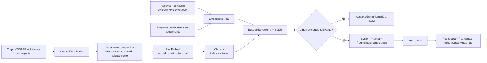

# Tutor TOGAF — Avance 2

Asistente académico para consultar extractos de **TOGAF 9.1** mediante recuperación
aumentada por generación (RAG). El proyecto conserva el System Prompt del Avance 1,
incluye ejemplos Few-Shot y devuelve respuestas JSON con el tema, explicación, ejemplo
y nivel. La interfaz muestra por separado los documentos y páginas recuperados.

## Alcance del corpus

El corpus disponible para esta entrega está compuesto por seis extractos:

- Introducción al ADM.
- Fase preliminar.
- Fase A: Architecture Vision.
- Fase B: Business Architecture.
- Fase C: Data Architecture.
- Fase C: Application Architecture.

Se eligieron estos extractos porque cubren la introducción y preparación del ADM, junto con
las fases A y B y dos vistas de la fase C disponibles para este proyecto. Así el tutor puede
responder preguntas desde el marco general hasta ejemplos de dominios concretos con citas
de página. El corpus no incluye el capítulo de Technology Architecture (fase D) ni el resto
de TOGAF 9.1, por lo que el asistente debe indicar esa limitación cuando corresponda.

La fase D y otros capítulos no están incluidos. El tutor debe reconocer esa limitación
y abstenerse cuando los fragmentos recuperados no permitan responder.

Los seis PDF autorizados forman parte del repositorio en `data/source_documents/` y se
cargan automáticamente como corpus predefinido. El estudiante no tiene que subir los
documentos ni crear el índice manualmente. Solo se deben mantener aquí documentos cuyo
uso y distribución estén autorizados.

## Flujo RAG



### Decisiones técnicas

| Componente | Decisión | Motivo |
| --- | --- | --- |
| Extracción | `pypdf` en modo de diseño + `fontTools`, `python-docx` y BeautifulSoup | El modo de diseño de pypdf conserva mejor los límites entre palabras en estos PDF; `fontTools` permite interpretar fuentes CFF Type1 que aparecen en ellos. |
| Chunking | 450 caracteres, solapamiento de 80; respeta límites de párrafo, oración y palabra, y no cruza páginas de PDF | El modelo de embeddings admite 128 tokens por entrada; fragmentos más cortos reducen el riesgo de que se trunque su contenido al vectorizarlo. El solapamiento conserva contexto en los cortes y cada cita mantiene su página. |
| Embeddings | `sentence-transformers/paraphrase-multilingual-MiniLM-L12-v2` mediante FastEmbed/ONNX | Modelo multilingüe local para preguntas en español y documentos mayormente en inglés; no requiere llamadas de embeddings a una API. El nombre del modelo y los parámetros de fragmentación quedan guardados en los metadatos de la colección. |
| Índice | Chroma con distancia coseno | Persiste localmente en `data/chroma/`; la app usa una colección temporal por sesión. |
| Recuperación | búsqueda vectorial y léxica BM25, consultas cortas español-inglés, umbral inicial 0.55 y `top_k=5` | Mantiene cada equivalencia separada para no diluir la consulta; BM25 ayuda con nombres y siglas exactas. Busca candidatos antes de limitar los fragmentos que se envían al modelo. |
| Generación | GroqCloud con `openai/gpt-oss-20b` por defecto | Mantiene el System Prompt, Few-Shot, delimitadores y formato JSON del Avance 1; usa Structured Outputs, esfuerzo de razonamiento bajo y un límite de 2048 tokens de salida para dejar espacio al JSON en respuestas extensas. |

El diagrama vectorial del ciclo ADM de la página 4 de `TOGAF_V9.1-Introduccion.pdf`
no produce etiquetas en la extracción de texto. `documents.py` agrega una transcripción
manual de sus rótulos con los mismos metadatos de documento y página para que la secuencia
y la Gestión de Requisitos sean recuperables y citables.

Los parámetros 450/80 y el umbral 0.55 son la configuración inicial documentada. La
evaluación compara `top_k=3` (línea base) con `top_k=8` (candidata), manteniendo iguales
los demás parámetros. La candidata solo debe llamarse “mejora” si los resultados Ragas
lo respaldan.

## Privacidad y servicios externos

- Los embeddings se generan con FastEmbed/ONNX en el proceso que ejecuta la app: en el
  equipo durante el uso local o en el servidor de Streamlit durante el uso público. La
  primera ejecución descarga el modelo desde Hugging Face; los documentos no se cargan allí.
- El corpus está versionado junto al código porque se cuenta con autorización para
  incluirlo. Streamlit lee esos PDF desde `data/source_documents/` y prepara el índice
  en memoria del proceso; el estudiante no carga documentos. La instancia puede volver
  a construir el índice después de reiniciarse.
- Solo la pregunta, el historial reciente y los fragmentos recuperados se envían a
  Groq para generar una respuesta. Ragas también envía a Groq las preguntas, respuestas,
  referencias y contextos recuperados para calificarlos.
- Groq indica que no retiene por defecto los datos de inferencia; puede conservarlos
  temporalmente hasta 30 días para investigar abuso o resolver problemas de fiabilidad.
  Sus condiciones también indican que no usa entradas y salidas para entrenar modelos
  salvo autorización expresa. Consulta [el manejo de datos](https://console.groq.com/docs/your-data),
  el [acuerdo de servicio](https://console.groq.com/docs/legal/services-agreement) y los
  controles de retención antes de cargar material privado.
- Groq **también tiene límites**: la cuota depende del modelo y la cuenta, e incluye
  solicitudes y tokens por minuto/día. El plan gratuito está limitado; el plan Developer
  ofrece cuotas mayores y cobra por uso. El modelo predeterminado tiene una ventana de
  contexto de 131,072 tokens y un máximo de 65,536 tokens de salida. Consulta los
  [límites vigentes](https://console.groq.com/docs/rate-limits), [modelos y precios](https://console.groq.com/docs/models)
  y [datos](https://console.groq.com/docs/your-data) antes de ejecutar la evaluación completa.
- Nunca agregues `.env`, `secrets.toml` ni índices locales a Git. El corpus TOGAF que se
  mantiene en Git es el conjunto autorizado descrito arriba.

## Instalación local

Para desarrollo local se recomienda Python 3.13. Python 3.14 puede requerir compilar
dependencias de Ragas que no tienen wheel disponible en todos los entornos.

```powershell
git clone https://github.com/skallenfreck/TOGAF-Tutor.git
cd Tutor-TOGAF
python -m venv .venv
.\.venv\Scripts\Activate.ps1
python -m pip install -r requirements.txt
Copy-Item .env.example .env
```

Edita `.env` localmente y asigna `GROQ_API_KEY`. No pegues la clave en GitHub ni en el chat.

Los seis documentos TOGAF autorizados ya están incluidos en `data/source_documents/`.
La interfaz construye automáticamente el índice en memoria al abrirse. Para crear o
actualizar el índice local persistente para consultas por consola:

```powershell
python -m scripts.build_index
```

Ejecuta el modo de consola:

```powershell
python -m src.main
```

La primera carga de embeddings puede descargar aproximadamente 220 MB desde Hugging
Face. El texto y los vectores resultantes se guardan en el equipo, bajo `data/chroma/`.

## Interfaz conversacional

Inicia Streamlit desde la raíz del repositorio:

```powershell
streamlit run app.py
```

El tutor carga automáticamente el corpus incluido y prepara el índice la primera vez
que se inicia cada proceso. No hay que subir PDFs ni pulsar un botón de creación. La
conversación conserva turnos para resolver preguntas de seguimiento. En cada respuesta,
abre **Evidencia** para revisar cuántos fragmentos y documentos distintos se usaron,
además del archivo, página y texto recuperado. El índice se comparte como recurso
lectura entre las sesiones del proceso de Streamlit.

## Evaluación Ragas

`evaluation/questions.json` contiene 18 preguntas redactadas para los seis extractos:
15 con respuesta en el corpus y 3 sin respuesta disponible. Cada pregunta incluye una
respuesta de referencia y, cuando corresponde, el PDF y la página esperados.

La evaluación ejecuta ambos valores de `top_k` y calcula **faithfulness**,
**answer_relevancy**, **context_precision** y **context_recall**. También genera un
resumen de control de abstenciones para los casos ausentes del corpus.
El tutor y Ragas usan la misma `GROQ_API_KEY`; la evaluación se conecta al endpoint
compatible con OpenAI de Groq para evitar incompatibilidades del adaptador de Ragas.
El script guarda cada respuesta y cada fila de métricas en checkpoints locales dentro
de `evaluation/results/`. Si Groq interrumpe la ejecución por cuota, vuelve a correr el
mismo comando para reanudar; si cambias el corpus, las preguntas, el modelo o los
parámetros, elige una carpeta `--output` nueva.

```powershell
python -m scripts.evaluate_ragas
```

Para una ejecución piloto, puedes limitar el número de preguntas antes de lanzar la
comparación completa:

```powershell
python -m scripts.evaluate_ragas --limit 3
```

La ejecución completa genera solicitudes a Groq tanto para responder las preguntas
como para juzgar las métricas Ragas. Puede consumir parte de la cuota gratuita o generar
un cobro si la cuenta tiene el plan Developer. Los resultados y textos intermedios se
guardan localmente bajo `evaluation/results/`, carpeta excluida de Git. No incluyas
fragmentos del corpus ni archivos intermedios en un repositorio público.

## Avance 3: herramienta de búsqueda del agente

`src/agent/tools.py` contiene las herramientas del agente. `buscar_en_base` envuelve el
recuperador híbrido del RAG; su docstring explica cuándo usarla. Los límites están en
código, no dependen del prompt: máximo 5 fragmentos por llamada, 900 caracteres por
fragmento y 1.000 caracteres por consulta. Cada resultado incluye documento, página o
sección, similitud y texto para citar. La herramienta no llama a Groq.

`generar_referencia_apa` es la herramienta determinista de tarea del dominio: verifica
que el PDF pertenezca al corpus, valida la página contra el archivo real y devuelve una
referencia con metadatos bibliográficos configurados, sin pedir al modelo que los recuerde.
`buscar_en_web` sigue la política **primero la base**: el programa ofrece la herramienta
al modelo, pero no la ejecuta hasta haber consultado primero la base. Si el modelo pide
la web antes, el código ejecuta la búsqueda local y luego continúa con la consulta web.
Solo se usa si falta información pública o actual. El programa pasa exclusivamente la
pregunta del estudiante; nunca envía fragmentos del corpus ni argumentos textuales del
modelo. La tool devuelve como máximo 3 resultados con título, URL, extracto de hasta 500
caracteres y marca `origen: web`. Si Bing no entrega resultados, para preguntas de
versión/actualidad TOGAF intenta consultar directamente el portafolio oficial de The
Open Group.

La lista fija de dominios permitidos está en `ALLOWED_WEB_DOMAINS` dentro de
`src/agent/tools.py`: `opengroup.org`, `iso.org`, `nist.gov`, `gov.co` y `europa.eu`.
Se priorizan el organismo de TOGAF, organizaciones de estándares y sitios oficiales
gubernamentales o de la Unión Europea. La herramienta agrega los filtros de dominio a
la consulta y descarta en código cualquier URL que no pertenezca a esa lista; el LLM no
puede modificarla. Si no hay resultados permitidos, el agente mantiene su abstención.
La búsqueda consulta Bing y valida cada URL contra la lista fija anterior; solo devuelve
coincidencias permitidas. Requiere conexión a Internet.

La interfaz conversacional usa este agente y conserva los turnos en el historial de la
sesión para resolver preguntas de seguimiento. Debajo de cada respuesta se puede abrir
**Herramientas usadas** para ver el nombre de cada tool, sus argumentos y el número de
llamadas al LLM. Las evidencias aparecen en secciones independientes: **Fuentes de la
base de conocimiento** (documento, página/sección y fragmento) y **Fuentes web**
(título, URL y extracto). Si ni el corpus ni la búsqueda web permitida aportan evidencia,
el agente muestra la abstención definida para el tutor en lugar de responder de memoria.
La interfaz nunca muestra ni solicita claves; localmente lee `GROQ_API_KEY` del entorno
o `.env`, y en Streamlit Community Cloud de los secretos de la app. La búsqueda web
actual usa Bing y no requiere una clave adicional.

`src/agent/runner.py` implementa el bucle de llamadas a herramientas con un máximo de
4 iteraciones y hasta 3 llamadas paralelas por iteración. El agente puede buscar más de
una vez para descomponer preguntas con varios temas. Saludos y conversación casual no
requieren búsqueda; una pregunta factual de TOGAF sin resultados de herramienta recibe
la abstención exacta definida en `src/rag/pipeline.py`. La respuesta final conserva el
formato estructurado y añade citas en `fuentes`. El prompt del agente está en
`prompts/system_prompt.py`; el prompt anterior se conserva aparte para reproducir la
evaluación Ragas del Avance 2.

Cada interacción escribe en `logs/tool_usage.jsonl` la pregunta, herramientas usadas,
argumentos, iteraciones y número total de llamadas al LLM. El log se excluye de Git para
no publicar preguntas de estudiantes. Se puede cambiar la ruta con `TOOL_USAGE_LOG`.

Se puede demostrar directamente, sin usar el LLM ni consumir tokens de Groq:

```powershell
python -m scripts.smoke_knowledge_tool
```

El script prepara un índice temporal del corpus y ejecuta `.invoke()` con una pregunta
de ejemplo. La primera ejecución puede descargar el modelo de embeddings local; el
resultado impreso muestra los fragmentos y sus fuentes.

Resultado observado sin llamada al LLM: la pregunta «¿Cuál es el objetivo de la fase de
Visión de Arquitectura?» devolvió 5 fragmentos; el primero fue
`TOGAF_V9.1-VisionArquitectura.pdf`, página 2, similitud `0.8229`. La respuesta completa
de `.invoke()` incluye también el texto de cada fragmento y sus metadatos de cita.

## Despliegue público

1. Confirma que el código esté en `main` del repositorio de GitHub.
2. Entra a [Streamlit Community Cloud](https://share.streamlit.io/) e inicia sesión con
   GitHub.
3. Crea una app desde el repositorio `skallenfreck/TOGAF-Tutor`, rama `main` y archivo
   de entrada `app.py`.
4. Selecciona Python 3.13 y agrega `GROQ_API_KEY` en los secretos de la app; no la
   agregues a un archivo del repositorio.
5. Despliega y espera a que la app lea el corpus incluido y prepare el índice; el primer
   arranque también descarga el modelo local de embeddings si aún no está en caché.
6. Copia la URL que Streamlit asigne y actualiza la sección siguiente.

**URL pública de la app:** https://togaf-tutor-gvt5yxbedckatvnvha3xei.streamlit.app/

**Repositorio GitHub:** <https://github.com/skallenfreck/TOGAF-Tutor>

## Informe de la entrega

El informe PDF con el diagrama RAG, decisiones técnicas, tabla y análisis de Ragas y
capturas de la aplicación se encuentra en
[`output/pdf/Informe_Avance2_Tutor_TOGAF.pdf`](output/pdf/Informe_Avance2_Tutor_TOGAF.pdf).
Después de completar `evaluation/results/completa_18_principal`, se puede regenerar
con `python -m scripts.build_avance2_report` (requiere `reportlab`, incluido en
`requirements.txt`).

## Archivos principales

- `app.py`: interfaz de chat para Streamlit.
- `src/rag/documents.py`: extracción y chunking con metadatos de fuente/página.
- `src/rag/embeddings.py`: embeddings FastEmbed locales.
- `src/rag/vector_store.py`: índice Chroma persistente o temporal.
- `src/rag/pipeline.py`: recuperación, umbral y abstención.
- `src/rag/generation.py`: integración Groq y salida JSON estructurada.
- `prompts/system_prompt.py`: System Prompt y ejemplos Few-Shot del tutor.
- `scripts/build_index.py`: construcción local del índice persistente.
- `scripts/evaluate_ragas.py`: comparación Ragas antes/después.
- `scripts/evaluate_agent.py`: evaluación comparativa RAG fijo/agente, Ragas, casos de comportamiento y costo.
- `evaluation/agent_behavior_cases.json`: siete casos y expectativas definidas antes de la ejecución.
- `evaluation/avance2_baseline_metrics.csv`: métricas del RAG fijo por pregunta para la comparación con el agente.
- `scripts/build_avance2_report.py`: generación del informe PDF desde los checkpoints Ragas.
- `evaluation/questions.json`: 18 preguntas y respuestas de referencia.
- `data/source_documents/README.md`: cómo preparar el corpus privado.

## Avance 3: evaluación del agente

`evaluation/agent_behavior_cases.json` contiene siete casos con el comportamiento
esperado escrito antes de ejecutarlos: saludo, pregunta compuesta, dos tareas APA,
consulta pública actual, respuesta disponible en el corpus e instrucción maliciosa.
`scripts/evaluate_agent.py` ejecuta estos casos y registra tools, argumentos, llamadas
al LLM, tokens informados por Groq, duración, resultado esperado y cumplimiento.

El mismo script ejecuta las 18 preguntas de `evaluation/questions.json` contra el RAG
fijo (`top_k=3`) y el agente, calcula las cuatro métricas Ragas para el agente y produce
`metrics_comparison.csv`, `cost_comparison.csv`, `agent_scores_by_question.csv` y
`behavior_results.csv` dentro de `evaluation/results/avance3_agent/`. El archivo
`evaluation/avance2_baseline_metrics.csv` conserva las métricas por pregunta del RAG
fijo ya evaluado en Avance 2 para formar la comparación pareada sin volver a consumir
cuota evaluando de nuevo sus métricas.

```powershell
python -m scripts.evaluate_agent
```

La medición de costo cuenta llamadas, tokens de entrada/salida reportados por Groq y
latencia de respuesta para las solicitudes de generación; excluye los tokens de las
llamadas de evaluación que Ragas realiza como juez. Los resultados intermedios se
guardan localmente y permiten reanudar una ejecución interrumpida. Para un piloto se
puede usar `--limit 2`; la entrega formal debe ejecutarse sin `--limit`.
